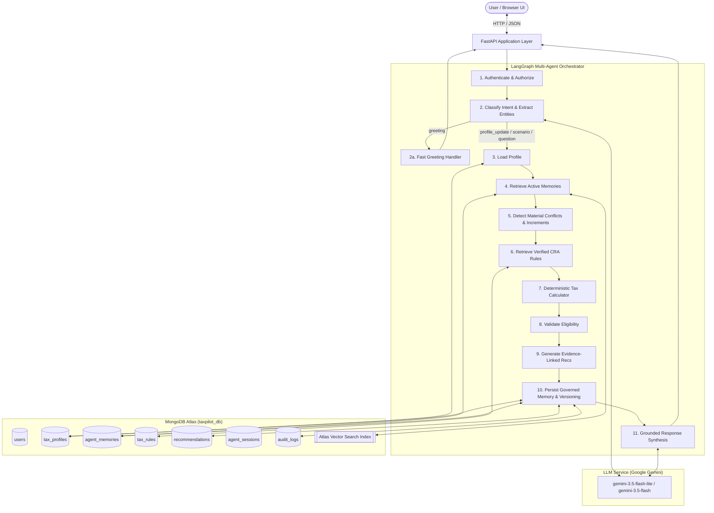
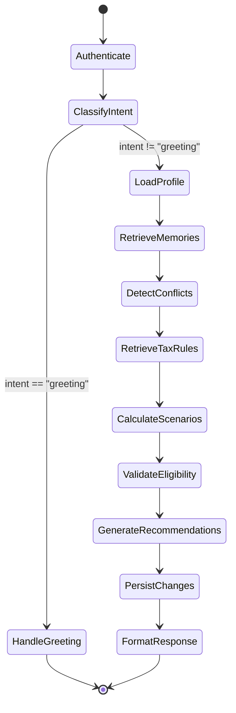

# 🏗️ TaxPilot AI — System Architecture & Technical Specifications

> **Hackathon Track:** Statement Two: Memory You Can Govern  
> **Jurisdiction:** Canada (Ontario MVP) • Tax Year 2025  
> **Tech Stack:** MongoDB Atlas • Atlas Vector Search • LangGraph • Google Gemini • FastAPI • Tailwind CSS

---

## 1. High-Level Architecture Overview

TaxPilot AI combines a **user-governed memory layer in MongoDB Atlas**, a **deterministic Canadian tax calculation engine**, and a **LangGraph state machine orchestrated with Google Gemini**.



---

## 2. Core Architectural Invariants

1. **Canonical State in MongoDB Atlas:** MongoDB Atlas (`taxpilot_db`) is the sole system of record for taxpayer profiles, memories, sessions, recommendations, rules, and immutable audit logs.
2. **Zero LLM Arithmetic:** LLMs **never** compute taxes, marginal brackets, surtaxes, or RRSP deductions. All mathematics are strictly calculated by deterministic Python modules grounded in verified CRA and Ontario Ministry of Finance rules.
3. **Strict Server-Side Tenant Isolation:** Every database operation enforces `user_id` derived exclusively from the authenticated principal (`x-user-id` header or authenticated session). Request body tenant IDs are never trusted.
4. **Governed Memory Lifecycle:** Stored facts are explicit, inspectable, correctable, and erasable. When circumstances evolve, prior facts are transitioned to `superseded` and explicitly linked to their replacement. When erased, content and vectors are wiped while audit references remain.
5. **Separation of Fact vs. Hypothesis:** Factual statements (e.g., *"I received a promotion and a $20k raise"*) trigger profile versioning and memory supersession. Hypothetical simulations (e.g., *"What if my salary is $95k?"*) are modeled in memory without mutating stored profiles.
6. **Pre-filtered Atlas Vector Search:** All vector search queries strictly enforce pre-filters: `user_id` and `governance.status == 'active'`.

---

## 3. MongoDB Atlas Data Contracts (7 Collections)

| Collection | Role | Key Fields | Governance Invariants |
| :--- | :--- | :--- | :--- |
| `users` | Identity & Roles | `_id`, `email`, `display_name`, `role`, `status` | Role-based permissions (`taxpayer`, `admin`). |
| `tax_profiles` | Canonical Tax Profile | `user_id`, `jurisdiction`, `tax_year`, `profile_version`, `employment_periods`, `financial_context` | Optimistic concurrency control via `profile_version`. |
| `agent_memories` | Long-Term Governed Facts | `user_id`, `memory_type`, `content`, `embedding`, `governance`, `source` | Stores 384-dimensional embeddings; status transitions: `active` → `superseded` / `deleted`. |
| `tax_rules` | Official Government Tax Rules | `rule_id`, `jurisdiction`, `tax_year`, `category`, `rule_name`, `source_url`, `source_authority`, `rule_body` | Immutable reference data citing official CRA and Ontario statutes. |
| `recommendations` | Evidence-Linked Strategies | `user_id`, `tax_year`, `recommendation_type`, `title`, `estimated_tax_saving`, `eligibility`, `evidence` | Captures mathematical before/after deltas and statutory references. |
| `agent_sessions` | Conversational Sessions | `session_id`, `user_id`, `state_summary`, `message_history` | Session boundary isolation. |
| `audit_logs` | Immutable Governance Ledger | `user_id`, `event_type`, `entity_type`, `entity_id`, `action`, `actor`, `metadata` | Permanent audit record of fact creation, supersession, and erasure. |

---

## 4. LangGraph Multi-Agent Workflow

The conversational engine is implemented as a compiled **LangGraph StateGraph** ([orchestrator.py](file:///c:/Users/nimba/Desktop/Hackathon/tax_agents/backend/app/graph/orchestrator.py)):

### State Schema (`AgentState`)
```python
class AgentState(TypedDict):
    user_id: str
    session_id: str
    request: str
    intent: str
    consent_verified: bool
    profile: Optional[Dict[str, Any]]
    retrieved_memories: List[Dict[str, Any]]
    proposed_memory_changes: List[Dict[str, Any]]
    tax_rules: List[Dict[str, Any]]
    analysis: Dict[str, Any]
    calculations: Dict[str, Any]
    eligibility_results: List[Dict[str, Any]]
    recommendations: List[Dict[str, Any]]
    missing_information: List[str]
    approval_required: bool
    audit_events: List[Dict[str, Any]]
    final_response: Dict[str, Any]
    error: Optional[str]
```

### Execution Flow & Conditional Router



1. **`authenticate`:** Resolves user identity from security context; halts if unauthorized.
2. **`classify_intent`:** Fast deterministic check for greetings + Gemini NLP parser for compound intents (factual life changes vs. hypothetical what-ifs).
3. **`handle_greeting`:** Returns a personalized, context-aware greeting displaying the loaded profile without triggering costly calculations or modifying Atlas state.
4. **`load_profile`:** Loads the canonical 2025 Ontario tax profile from Atlas.
5. **`retrieve_memories`:** Executes vector search with cosine similarity and mandatory metadata prefilters (`user_id`, `active`).
6. **`detect_conflicts`:** Identifies whether the user reported a new salary or relative raise (e.g., `+$20k`), computing the new total income against baseline.
7. **`retrieve_tax_rules`:** Pulls verified CRA 2025 Federal & Ontario brackets and statutory RRSP limits.
8. **`calculate_scenarios`:** Deterministic calculation engine:
   - Federal progressive brackets (15.0% to 33.0%) & Basic Personal Amount ($16,129 CAD).
   - Ontario provincial brackets (5.05% to 13.16%), BPA ($12,692 CAD), and Ontario surtaxes (20% & 36%).
   - RRSP What-If marginal rate deduction savings.
9. **`validate_eligibility`:** Checks deduction limits against CRA Notice of Assessment caps.
10. **`generate_recommendations`:** Formulates evidence-linked recommendations with exact before/after savings deltas.
11. **`persist_changes`:** Increments `profile_version` with optimistic concurrency, archives old memories as `superseded` (storing replacement pointers), creates new active memories, and writes immutable audit entries.
12. **`format_response`:** Gemini synthesizes an explainable, encouraging markdown response grounded strictly in the calculated numbers and Atlas memory provenance.

---

## 5. Atlas Vector Search Index Specification

Defined in `data/seed/vector_index_definition.json`:

```json
{
  "name": "memory_vector_index",
  "type": "vectorSearch",
  "definition": {
    "fields": [
      {
        "type": "vector",
        "path": "embedding",
        "numDimensions": 384,
        "similarity": "cosine"
      },
      { "type": "filter", "path": "user_id" },
      { "type": "filter", "path": "memory_type" },
      { "type": "filter", "path": "governance.status" }
    ]
  }
}
```

---

## 6. Security, Privacy & Tenant Isolation

* **X.509 Client Authentication:** Mutual TLS authentication with MongoDB Atlas via client certificates (`.pem`).
* **Tenant Isolation:** All repository methods require an explicit `user_id` parameter and inject it into MongoDB filter queries (`{"user_id": ObjectId(user_id)}`).
* **Erasure Compliance:** When a user requests deletion of a memory:
  - Textual content is scrubbed.
  - Vector embeddings are purged (`"embedding": null`).
  - Governance status is set to `deleted` with a mandatory deletion timestamp and audit reason.
  - A permanent audit record is created in `audit_logs` without storing the erased payload.
